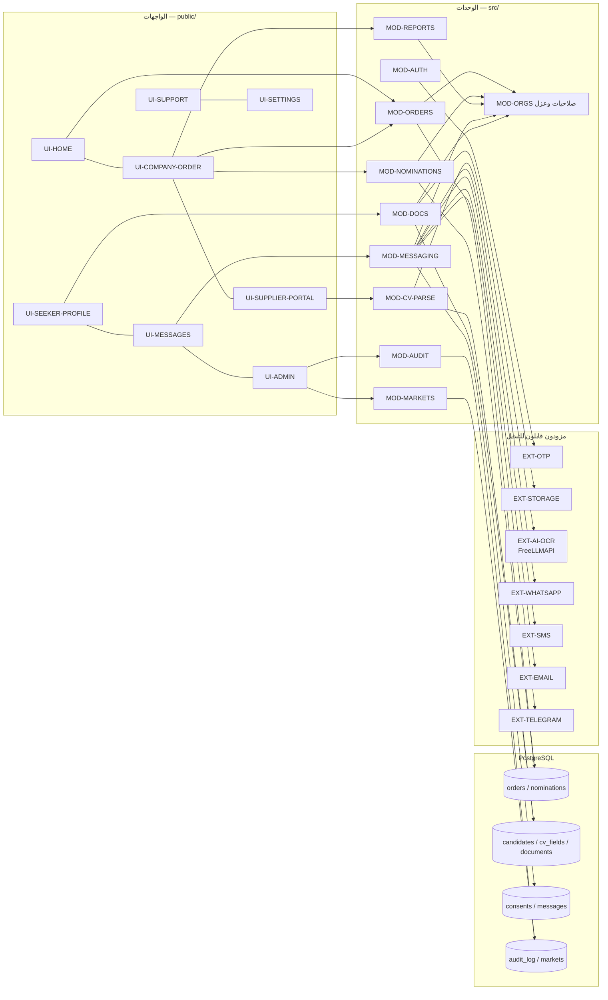

# المعمارية الهندسية — وصلة عمل

الخريطة الكاملة في `graph.json` (عُقد + علاقات زمنية + حلقات). لكل جزء معرّف ثابت مكتوب كتعليق في الكود، مثل `// [MOD-NOMINATIONS]` أو `<!-- [UI-SHELL] -->`.

**للوصول لجزء:** `grep -rn "\[MOD-REPORTS\]" src public`
**قبل أي تعديل:** `npm run impact -- MOD-REPORTS 2` يعرض كل ما قد يتأثر.
**بعد التعديل:** عدّل `architecture/build-graph.js` (العلاقة القديمة تأخذ `invalid_at` ولا تُحذف)، شغّل `node architecture/build-graph.js`، وأضف حلقة في `CHANGELOG.arch.md`.

## قواعد العمل
| المعرّف | القاعدة | المكان |
|---|---|---|
| RULE-GAP | العجز = المطلوب − المؤهل؛ المتبقي = المطلوب − المباشر | `src/lib/core.js#orderKpis` |
| RULE-NO-DUP-NOMINATION | لا يُضاف الشخص مرتين للطلب (قيد UNIQUE + فحص) | `src/modules/orders.js#nominate` |
| RULE-CONSENT-BEFORE-SHARE | الاسم والجوال والرسائل حسب موافقة المرشح النشطة | `orders.js#present`, `#recipients` |
| RULE-EXPORT-DEFAULT-COLUMNS | التصدير الافتراضي بلا اسم/جوال/هوية/إقامة | `orders.js#DEFAULT_COLS` |
| RULE-AGE-EXCLUDED | العمر من تاريخ ميلاد صريح فقط، خارج الترتيب والتصدير | `core.js#match`, `ai.js` |
| RULE-CV-IS-DATA | نص السيرة مسوّر ولا تُنفَّذ تعليماته، ولا يرى النموذج مفاتيح أو أدوات | `src/providers/ai.js` |

## مسار الاعتماد
- **شركة كبرى:** منشئ الطلب ← مراجع فني (`tech-review`) ← معتمد نهائي (`approval`). الاعتماد النهائي يُرفض قبل اجتياز المراجعة الفنية.
- **منشأة صغيرة:** دور واحد `single_admin` يراجع ويعتمد.
- كل اعتماد وإرجاع يُسجَّل مع سببه في `audit_log`.

## القرارات (ADR)
- **ADR-001** تطبيق وحدوي (Express + PostgreSQL) بوحدات منفصلة منطقيًا؛ الفصل لخدمات لاحقًا عند الحاجة.
- **ADR-002** `pg-mem` للتشغيل التجريبي بنفس SQL، و`DATABASE_URL` للتشغيل الفعلي.
- **ADR-003** واجهة Vanilla JS بلا خطوة بناء، مع CSP صارم بلا سكربتات أو أنماط مضمنة.
- **ADR-004** استخراج السير عبر أي مزود متوافق مع OpenAI (FreeLLMAPI محليًا افتراضيًا)، مع احتياط محلي.
